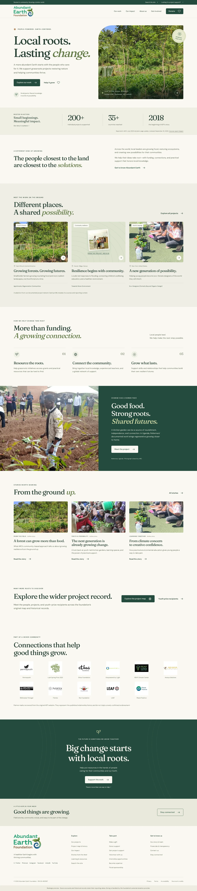

# Abundant Earth Foundation

A researched, responsive redesign of **abundantearthfoundation.org**, built around local leadership, regenerative growing, and community resilience.

**Status:** implemented and tested locally. The repository contains a deployable static site; it has not been published to the foundation’s domain. Verified payment/signup providers, current organizational details, and production hosting still need to be connected or confirmed. The default build is a clearly labeled, non-indexable preview.



## What is included

- An editorial homepage with a warm green-and-cream design, responsive typography, and locally hosted project photography.
- **28 pages**, including six project profiles, three archive-based stories, impact reporting, the foundation’s story and historical team, financials, learning resources, and participation pages.
- A project directory with combined text, focus-area, and country filters, shareable filter URLs, result announcements, and an empty state.
- Giving journeys for general/project-specific and one-time/monthly support. Verified checkout URLs can be configured without changing templates.
- A newsletter-provider handoff and accessible contact, volunteering, sponsorship, and project-support inquiry helpers.
- Honest integration states: unconfigured providers offer email inquiries; email drafts are reviewed and sent by the visitor. No simulated payments, submitted messages, or subscriptions.
- **15 legacy redirects**, including inbound ARC donation links with preserved project selection.
- Search metadata, canonical URLs, NGO structured data, a sitemap, and environment-controlled indexing.
- Keyboard navigation, reduced-motion support, meaningful image descriptions, native form validation, and no-JavaScript alternatives.
- A [Pages CMS](https://pagescms.org/) configuration for Git-based editing of projects, stories, foundation settings, impact, and public provider links.
- GitHub Actions checks and downloadable static-build artifacts.

## Run locally

Use **Node.js 24 LTS** (minimum supported by this project: 22.12).

```bash
npm ci
npm run dev
```

Open the URL printed by Astro, normally `http://localhost:4321`.

To test the production output:

```bash
npm run build
npm run preview
```

Astro 7 may start a background server when run by an agent. Use `npx astro preview status`, `npx astro preview logs`, or `npx astro preview stop` to manage it. The browser-test server runs separately on port **4322** in the foreground.

## Verification

```bash
npm run check
npm run test:unit
npm run build
npx playwright install chromium
npm test
npm run test:providers
npm audit
```

On Linux CI, install browser dependencies with `npx playwright install --with-deps chromium`.

The verification suite includes:

| Check | Coverage |
|---|---|
| Astro/TypeScript | Templates, browser scripts, and test configuration |
| Build verification | All generated local links and anchors, project/story references, required metadata, provider URL validation, and legacy redirect targets |
| 70 browser checks | Desktop and mobile page rendering, automated WCAG A/AA scans, overflow, filters, form validation, draft generation, navigation, 404s, images, and no-JavaScript alternatives |
| 6 provider-handoff checks | One-time and monthly checkout navigation, newsletter handoff, and protection against routing a project-specific gift to the general fund |
| 4 unit checks | Missing integrations, unsafe URL rejection, encoded email drafts, and fund/frequency routing |

`test:providers` builds with reserved `example.org` fixture URLs, intercepts those navigations locally, and **restores the normal build in a `finally` block**. It does not contact a payment provider or submit personal information. Do not run it concurrently with another build.

Automated accessibility results are not a claim of formal accessibility certification. Manually review keyboard use, zoom, screen-reader experience, and any connected external providers before launch.

## Content editing

Core content is separated from page templates:

| File | Purpose |
|---|---|
| `src/data/site.json` | Mission description, public contact address, social links, historical reach, and application status |
| `src/data/projects.json` | Project profiles, country/theme filters, outcome attribution, sources, and captions |
| `src/data/stories.json` | Editorial stories and related project references |
| `src/data/participation.json` | Volunteer, partnership, and fiscal-sponsorship copy |
| `src/data/integrations.json` | Public, verified hosted checkout and newsletter URLs |
| `src/data/redirects.json` | Old-to-new URL mappings |
| `src/pages/financials.astro` | Year-specific public financial records |
| `src/styles/global.css` | Shared design system and responsive rules |

For a browser-based editor, authorize the repository in [Pages CMS](https://app.pagescms.org/). It reads `.pages.yml` from the selected branch and saves content changes as Git commits. This configuration is included; the external CMS account/GitHub authorization is **not provisioned by this repository**.

Keep project slugs stable. When changing a slug, update story references and add a legacy redirect. Build checks catch missing references and images. Keep figures, reporting dates, and source notes together; never substitute partner-wide results for AEF-attributable results.

Image fields use an **image family name** such as `food-forest`, `education`, or `gardens`. A family has 480/960/1600 WebP variants in `public/images/`. Regenerate known source images with:

```bash
npm run media
# Or just one family:
npm run media -- education
```

These commands require network access; normal builds use committed assets and do not. The TGE archive only yielded a 150px thumbnail, so the design displays it in an archival frame rather than enlarging it into a blurry hero. Replace it with an approved original when available. See [content and asset notes](docs/CONTENT.md).

## Connect giving and newsletter services

Use `.env.example` as a reference for an ignored local `.env` or set the values in your hosting provider. **Only public URLs belong in these settings; no secret API keys are needed for hosted checkout.**

```dotenv
SITE_URL=https://abundantearthfoundation.org
PUBLIC_SITE_LIVE=false
PUBLIC_DONATION_URL=
PUBLIC_MONTHLY_DONATION_URL=
PUBLIC_NEWSLETTER_URL=
```

Alternatively, edit the corresponding fields in `src/data/integrations.json` / Pages CMS. Nonempty environment values take precedence.

For a project-specific provider page, add an entry to `projectDonationUrls`:

```json
{
  "slug": "agroforestry-regeneration-communities",
  "oneTimeUrl": "https://YOUR-VERIFIED-PROVIDER/PROJECT-CHECKOUT",
  "monthlyUrl": "https://YOUR-VERIFIED-PROVIDER/PROJECT-MONTHLY-CHECKOUT"
}
```

Replace those illustrative URLs with actual foundation-controlled provider links. Leave unavailable options empty. Validate the receiving organization, fund, frequency, receipts, and cancellation process at the provider before publishing the link.

The site does not append guessed Stripe/PayPal parameters, create charges, or claim a successful payment. Donors choose the amount and confirm the final designation on the provider’s page. An unconfigured project checkout **never falls back silently to a general donation**.

Newsletter signup occurs on a verified provider-hosted page, which should handle confirmation, unsubscribing, and subscriber records. Contact forms are intentionally browser-side email-draft helpers, not a message inbox or backend delivery service. The published contact mailbox’s deliverability has not been verified.

## Deploy

1. Connect the GitHub repository to a static hosting service with a **Node 24** build environment.
2. Set build command to `npm run build` and publish directory to `dist`.
3. Serve the site at the **root of its domain**. Subpath hosting such as `github.io/AbundantEarth/` is not configured.
4. Supply verified integration URLs and set `SITE_URL` to the real canonical origin.
5. Complete the content and ownership items in [operations](docs/OPERATIONS.md).
6. For the approved production release only, set `PUBLIC_SITE_LIVE=true` and rebuild. This removes the preview notice and allows indexing in meta tags and `robots.txt`.
7. Connect the domain, enable HTTPS, and verify the public site and inbound donation URLs.

The build generates `_redirects` and `_headers` for compatible static hosts. Other hosts should import `src/data/redirects.json` as **HTTP 301 redirects**; Astro also emits HTML meta-refresh fallback pages. Query strings embedded in donation redirects must be preserved. Configure unknown routes to serve `404.html` with HTTP 404 rather than redirecting all paths to the homepage.

No DNS changes, external CMS authorization, payment accounts, newsletter lists, or public hosting resources are created by this code. The CI workflow validates and uploads the site; it does not automatically deploy it.

## Research and editorial basis

The original site was unavailable during research. Most source pages were recovered from 2025 Wayback captures; funding application details came from January 2022. Public records were reviewed through ProPublica, and partner information through ARC and Eco-Designers.

The new site explicitly dates historical figures and team roles, distinguishes plans from outcomes, and links to source materials. Stories are editorial summaries of the archive, not invented interviews or fresh reporting.

- [Research and design decisions](docs/RESEARCH.md)
- [Content and photography provenance](docs/CONTENT.md)
- [Launch, maintenance, and recovery](docs/OPERATIONS.md)

Project photographs and source materials remain the property of their respective rights holders. This repository does not grant a new license to third-party assets. Confirm reuse permissions before public release.
